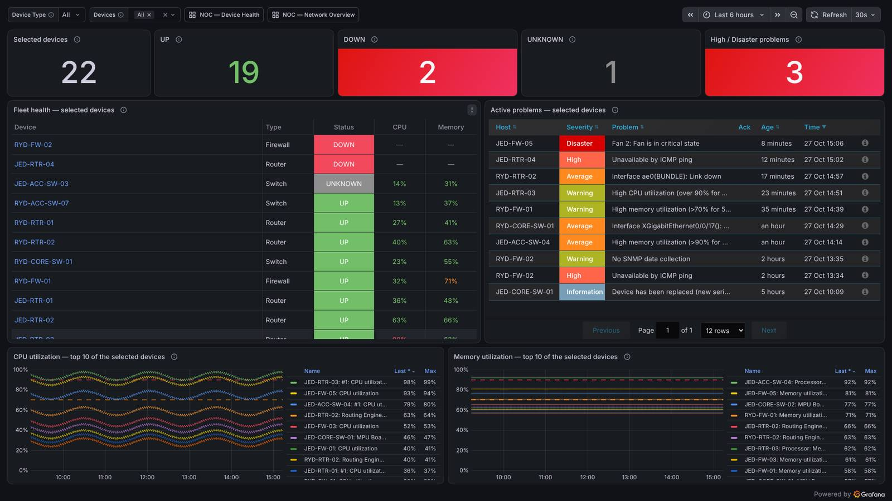

# NOC — Command Center (release 2.5.0): operator guide

The NOC wallboard for **any set of routers, switches and firewalls**. Folder **NOC**, uid `noc-command-center`
(`/d/noc-command-center`). Everything on it is read from Zabbix at view time; nothing names a device, host id, item id or interface.



## Choosing devices (Grafana only — no file, installer run or restart)

| Picker | What it offers | Notes |
|---|---|---|
| **Device Type** — All / Router / Switch / Firewall | the Zabbix host groups chosen for each type (same setting as the other NOC dashboards, `NOC_GROUPS_*`) | change the groups: `sudo grafana-platform setup --dashboards` |
| **Devices** — multi-select, type to search | every Zabbix host in those groups; **All** = all of them | pick 1, 9, 20 or more, mixed types |

* Click **Devices**, type part of a name, click the device; repeat; click outside the list to apply. Click a device again (or its ×) to remove it.
* The selection is in the address bar (`var-device=...` once per device): **bookmark the URL** or add it to a playlist to keep a wallboard
  for a site, a customer or a shift. Opening the URL restores exactly that selection.
* A host added to one of the type's host groups in Zabbix appears in the Devices list by itself (after the data source's cache time,
  5 minutes for the data source the installer manages).
* Wall display: append `&kiosk` to the URL (hides menus). The page refreshes every 30 s (change at the top right).

## What each part shows

| Part | Meaning |
|---|---|
| **Selected devices / UP / DOWN / UNKNOWN** | counted from the fleet table below, so they always agree with it. DOWN turns red when > 0. `—` = Zabbix did not answer (never a reassuring 0). |
| **High / Disaster problems** | Zabbix triggers in PROBLEM state with severity High or Disaster on the selected devices (monitored hosts; dependent triggers skipped). Red when > 0. |
| **Fleet health** (one row per device) | **Device** (click → **NOC — Device Health** for that device), **Type**, **Status**, **CPU**, **Memory**. Always sorted **DOWN (red) → UNKNOWN (gray) → UP (green)**, then by name; the order is computed in the table's query pipeline, so it is the same after every refresh and every change of the selection. `N/A` = not reported (never 0). |
| **Active problems** | the Zabbix problems of the selected devices, newest first, with severity, age and acknowledgement (the Zabbix plugin's own Problems panel). |
| **CPU / Memory — top 10** | the 10 highest series (peak in the time range) among the selected devices, using the same item rules as the table. Full per-device history: NOC — Device Health. |

Interface status and traffic are deliberately not on the wallboard (a fleet of switches has hundreds of ports, most "down" by design).
Link-down events reach the wallboard through the Zabbix problems; per-interface detail is one click away on NOC — Device Health.

## Status: how UP / DOWN / UNKNOWN is decided

Three availability items, each read only from the **last 10 minutes** (the panel's query window). An item with no sample in that window
is *stale* and counts for nothing. Each fresh item votes, and the votes have fixed weights:

| Item (exact Zabbix name) | Template | UP vote | DOWN vote |
|---|---|---|---|
| `ICMP ping` | ICMP Ping | +100 | −100 |
| `SNMP agent availability` | every 7.0 SNMP template | +10 | −10 |
| `Zabbix agent availability` | agent templates | +1 | −1 |

Availability `unknown` (2) is dropped (no vote). The device's **score** is the sum of the votes of its **latest** fresh samples:

* score > 0 → **UP**, score < 0 → **DOWN**, otherwise (no fresh item, or only "unknown") → **UNKNOWN**.
* **Precedence on conflict**: ICMP > SNMP > agent, because the weights differ by an order of magnitude. ICMP down + SNMP up = DOWN; ICMP up + SNMP
  down = UP (the device answers, its SNMP service is the fault: the problem list shows it); SNMP down + agent up = DOWN.
* **ICMP is never assumed**: a device without the ICMP template is decided by SNMP, then agent. No item at all → UNKNOWN.
* **Stale never means UP**: a device whose items stopped updating (collection stopped, host disabled, proxy down) becomes UNKNOWN after
  10 minutes, not UP and not DOWN.
* **CPU / memory data never makes a device UP.** A device with only CPU/memory items is listed as UNKNOWN.
* Items that report less often than every 5 minutes cannot be judged in a 10-minute window and show UNKNOWN; the Zabbix defaults
  (ICMP 1 m, SNMP availability 1 m) are fine.

### What was wrong in 2.4.0 (UNKNOWN and "Value = 100" for every device)

2.4.0 turned each availability item into one number per device (ICMP up → 1 × 101 − 1 = **100**, down → −1; SNMP and agent likewise), told
Grafana's *Reduce* transformation to name each row by the series' **field name** (`labelsToFields`), pivoted those names into columns
(`ICMP`, `SNMP`, `Agent`) and summed the columns. That works only if the Zabbix plugin names the field after the series. The plugin
(6.8.0, `convertToWide`) does so **only when the first two timestamps of every series are identical** (all items polled in the same second);
otherwise it keeps the field name `Value` for every series and puts the name only in a display name. On a real Zabbix server every item has its
own polling phase and polls are missed, so the timestamps never line up: every series was named `Value`, there was no `ICMP` / `SNMP` / `Agent`
column to sum, the status had nothing to add up (**UNKNOWN**) and the only number left in the table was the raw transformed ICMP sample
(**Value = 100** = ICMP up, exactly what you saw while Zabbix returned 1). The test data used in 2.4.0 had aligned timestamps, which is why its
tests passed; with out-of-phase timestamps the same 2.4.0 dashboard reproduces the production table (see Tested).
2.5.0 does not depend on the timestamp alignment: every series carries its **host and role in its own alias** (`AVI␟host`), the last sample of
every series is taken, the alias is split back into role and host, and the weighted sum is formed per host.

## CPU and memory: how the items are found (no per-vendor edits)

One deterministic order for every vendor; the first rule that finds a value for a device wins, and devices are decided independently
of each other, so Cisco, Huawei, Fortinet, Palo Alto, Gigamon and others mix in one table.

| Tier | Item name (case-insensitive, whole name anchored) | Examples that match | Value used |
|---|---|---|---|
| CPU 1 | `[prefix:] CPU\|Processor [total] utilization\|usage [(%)\|, %\|in %\|percent]` | `CPU utilization`, `#1: CPU utilization`, `MPU Board 0: CPU utilization`, `Data plane: CPU utilization`, `CPU usage` | as is |
| CPU 2 | `[prefix:] CPU\|Processor idle [time] (%)` (the unit must be given) | `CPU idle time, %` | 100 − idle |
| Memory 1 | `[prefix:] Memory utilization\|usage [%]`, `Used memory (%)` | `Memory utilization`, `Processor: Memory utilization`, `Memory usage, %` | as is |
| Memory 2 | `[prefix:] Free\|Available memory (%)` (the unit must be given) | `Free memory, %` | 100 − free |

Rules that make the choice safe:

* **Tier 1 beats tier 2** when a device has both (utilization is read, the idle/free value is ignored).
* **Several items in a tier** (two CPU boards, management + data plane, several memory pools): the **highest** is shown. Deterministic and the
  one a NOC needs (the busiest plane).
* **Never selected**: CPU temperature, fan, per-core / per-thread items (`CPU core 1 utilization`), load average, interrupt time, memory in
  bytes (`Memory used`, `Total memory`), swap, disk. Names must match completely, so a longer or different name is not picked up. Absolute
  values (bytes) are never mixed with percentages; a device whose memory exists only in bytes shows `N/A`.
* **Values outside 0–100 are discarded** (a broken counter shows `N/A`, not 250 %).
* **No tags needed**: the rules read item names, so an untagged template (Gigamon, custom) works. Tags are not used for CPU/memory because
  vendors tag differently (or not at all).
* **Missing = `N/A`**, never 0.
* Percent values are rounded to whole numbers; the table colours CPU/Memory green < 70 %, orange < 90 %, red from 90 %.

A vendor whose item has another name (for example `Utilization of the CPU`) shows `N/A` until its pattern is added **once** in
`tools/build-noc-command-center.py` (`METRICS`), then `python3 tools/build-noc-command-center.py` and a release: one change for every
device of that template, not a dashboard edit per device. `tests/unit/noc-command-center.test.mjs` shows the accepted and rejected names.

## HTTP 500 "request failed, status: 500 Internal Server Error"

The Zabbix data source answers API calls through the Zabbix frontend (`api_jsonrpc.php`). The text *request failed, status: 500* is the HTTP
status of the **Zabbix web server's** answer, not an error from the Grafana plugin or from the Zabbix API's JSON error object. It means PHP on the
Zabbix frontend failed while building the answer. From the evidence available without access to your servers the most likely cause is PHP
running out of memory (or time) while building an `item.get` answer that is far too large:

* the plugin's `item.get` returns *all* numeric items of the selected hosts and filters the item names inside Grafana. A switch with 48
  ports has several hundred items. 2.4.0 sent six such `item.get` calls per page load; with 100 selected devices on the test stand-in
  they returned **27 000 items in 6 calls, the largest 13 420** (measured);
* 2.5.0 asks for them **once** (the answer is cached for 5 minutes and shared by availability, CPU and memory) plus three small tag-scoped
  calls: **13 120 items in 3 calls, the largest 9 636**, about half;
* the old CPU/memory queries also depended on the tags `component: cpu / memory` and on very broad name patterns (anything containing
  "usage" or "load"), so they showed "No data" for templates without those tags and picked unrelated items where they existed.

This is a **reduction of the load, not a proof of the cause**: the exact reason is only visible in the Zabbix frontend's PHP/nginx log. To
confirm on production, look at the time of a 500 in the nginx/Apache error log and the PHP-FPM log of the Zabbix frontend, for
`Allowed memory size of ... bytes exhausted` or `Maximum execution time`. If that is what you see and the dashboard still gets a 500 on a very large
selection, raise `memory_limit` of the Zabbix frontend's PHP-FPM pool (for example `php_value[memory_limit] = 512M` in
`/etc/php-fpm.d/zabbix.conf`, then `systemctl reload php-fpm`; this is a Zabbix-server change, not a Grafana change) or select fewer devices.

## Which Zabbix items are used (vendor-neutral)

| Column | Zabbix items | Template |
|---|---|---|
| Status | `ICMP ping`, `SNMP agent availability`, `Zabbix agent availability` | ICMP Ping; every 7.0 SNMP template; agent templates |
| Type | the host groups chosen for Router / Switch / Firewall, shown for devices that have a fresh availability item (`—` otherwise) | any |
| CPU / Memory | by name, tiers above | official 7.0 templates (Cisco, Juniper, Huawei, FortiGate, Palo Alto, ...) and any template using these common names |
| Problems | `trigger.get` / `problem.get` for the selected hosts | any |

A device is listed when Zabbix has at least one of the availability, CPU or memory items for it. A device with none of them is not listed:
give it the ICMP Ping template.

## Install / update (this dashboard only)

```bash
curl -fsSL -x http://172.20.129.10:8080 https://codeload.github.com/jaber717/Grafana-Production-V2/tar.gz/refs/heads/main | tar xz -C /root && /root/Grafana-Production-V2-main/install.sh --command-center
```

This updates **only** the dashboard `noc-command-center`, through the Grafana API. No question is asked. It does not touch the other
dashboards, folders, data sources, plugins, `grafana.ini`, provisioning, playlists or the platform settings, and Grafana is not restarted.
The uid and the address `/d/noc-command-center/...` stay the same.

* **Backup first**: the current dashboard JSON is saved to `/var/lib/grafana-platform/backups/command-center/noc-command-center-v<N>-<time>.json`
  (root only) before it is replaced.
* **Rerun is safe**: when the dashboard already equals the release it says `unchanged`; no backup, no write, no new version.
* **Proof on every run**: the tool fingerprints every other dashboard (uid, version, folder, content), every data source and every plugin before and
  after, and prints `every other dashboard ... is identical to before` (exit code 4 and the differences if not).
* **It refuses** (and writes nothing) if Zabbix is not connected, the Zabbix data source or the NOC folder is missing, or the dashboard could only be
  deployed with a "setup incomplete" notice. Then the working dashboard stays as it is.
* **Roll back**: `GP_RESTORE_FILE=<backup file> /root/Grafana-Production-V2-main/install.sh --command-center` (run as root) puts that backup back.
* It uses the host groups saved earlier for Device Type (`NOC_GROUPS_*`); to change them use `sudo grafana-platform setup --dashboards`, which is the
  general step that imports all dashboards.

To customise the wallboard, use **Save as** in Grafana (a copy under a new name): the dashboard with uid `noc-command-center` is managed
by the installer and is reset to the release version when the dashboards step runs again.

## Tested, and what is left to confirm on your Zabbix

**Real:** Grafana 13.2.3 and Zabbix plugin 6.8.0 on AlmaLinux 9.8 (RHEL 9 rebuild), driven by a real browser, deployed by `install.sh --command-center` (the 2.5.0 browser runs used `--dashboards`; same dashboard content).
**Simulated:** the Zabbix server. `tests/noc/zabbix7-api.mjs` is a stand-in of the Zabbix 7.0 API (strict parameter checks, per-item poll phases and
missed polls with `--realistic`). **No test in this release ran against a real Zabbix server, and nothing ran on production.**

| Test | Result |
|---|---|
| `tests/noc/ui-matrix.py --bulk`: 26-device rule matrix (ICMP/SNMP/agent up/down/unknown, stale, ICMP vs SNMP vs agent conflicts, CPU-only, Cisco / Huawei / Fortinet / Palo Alto / untagged Gigamon naming, idle/free inversion, bytes and per-core only, multi-CPU/pool, out-of-range, no metrics), 9 / 30 / 100 devices, selection change, 30 s auto-refresh keeps the order | 57 / 57 |
| `tests/noc/ui-command-center.py` (24-device fleet, pickers, type filter, bookmark, refresh, drill-down) | 118 / 118 |
| `tests/unit` (item-name rules accepted/rejected, weights, sort) | 40 / 40 |
| `install.sh --command-center` 2.4.0 → 2.5.1, rerun, refusals, rollback (`tests/noc/single-dashboard-update.sh`; two other dashboards deliberately edited by hand beforehand) | 17 / 17: only `noc-command-center` changed (v→v+1); every other dashboard, data source and plugin identical; backup equals the previous JSON; rerun writes nothing; Grafana not restarted |
| release gate (includes the simulated installer, 89 checks) | PASS |

Evidence: [evidence/command-center-2.5.0/](evidence/command-center-2.5.0/). Limits of this evidence: it does not show how *your* templates
name their CPU/memory items, nor the cause of your HTTP 500. On production confirm after the update:

1. **Status**: a device you know is up shows UP (green), one you know is down shows DOWN (red) and is at the top; a device without ICMP shows
   SNMP/agent status, not UNKNOWN; the KPI tiles add up to the table.
2. **CPU / Memory** for 2–3 devices of each vendor (Cisco, Huawei, Fortinet, Palo Alto, Gigamon) against Zabbix → Monitoring → Latest data. `N/A`
   means that template's item name is not in the tiers above: send the exact item names and one rule is added for all devices.
3. **No `500`** with your usual selection (also 30–100 devices). If it still appears, read the Zabbix frontend PHP/nginx error log at that time
   (see the HTTP 500 section).
4. The Devices list per Device Type is right (else `sudo grafana-platform setup --dashboards`) and Active problems match Zabbix → Problems.
